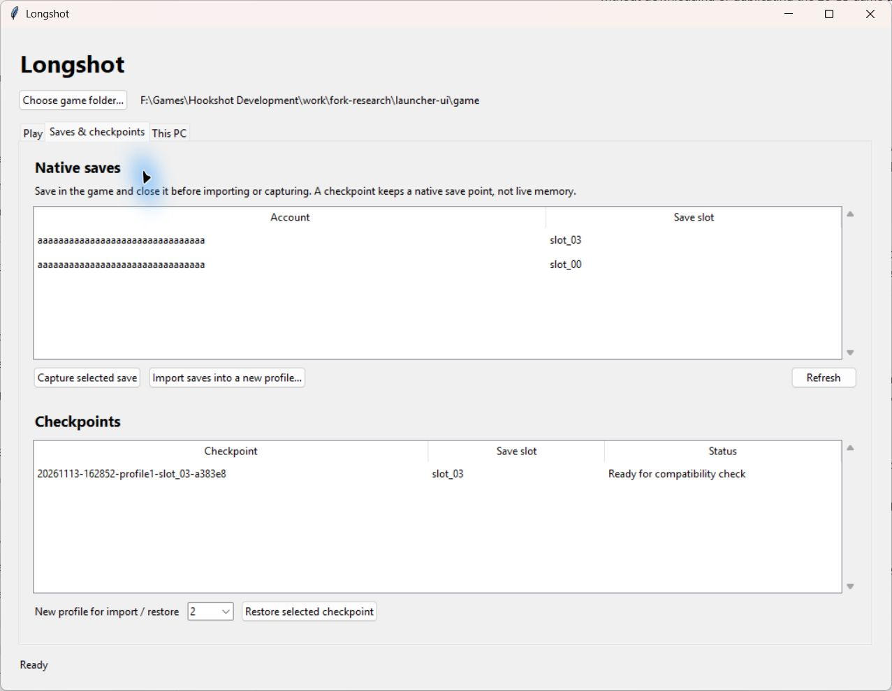
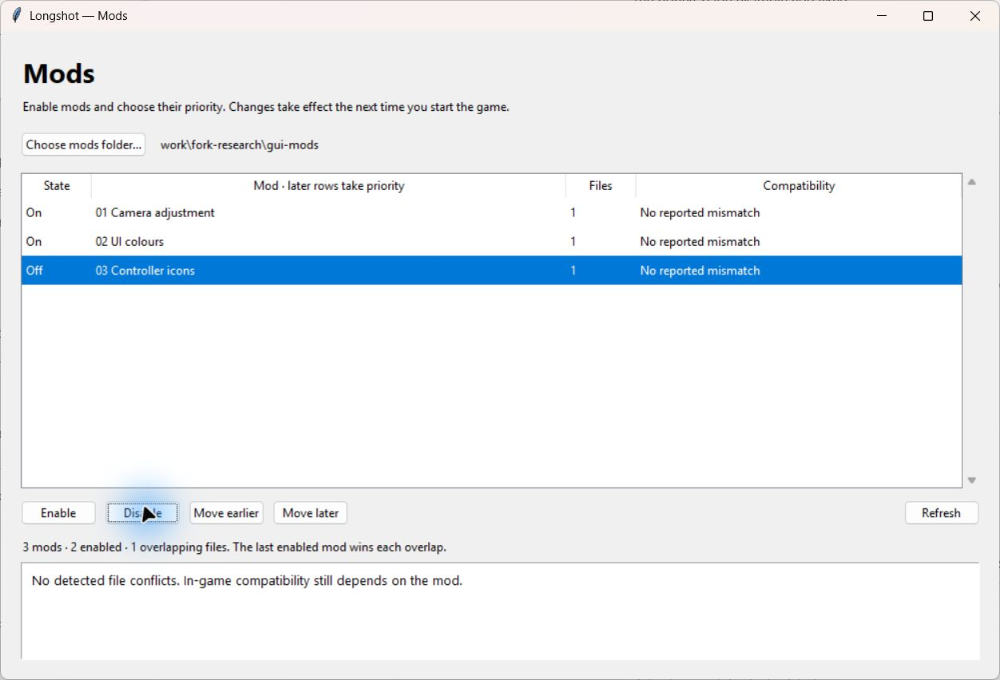

# Longshot integration branch

This branch combines Hookshot **v2.2.0-rc.1** with Longshot's checkpoint foundation, separate save profiles,
adjustable FPS text, a mod manager, and pinned co-op, randomizer and completion-tracker integrations.
It is a development build. See [validation](longshot-validation.md) for exactly what was tested and what still needs gameplay acceptance.

The [research report](longshot-fork-research.md) explains the selection, licenses and exclusions. The existing
play installation is not updated by these source changes or the companion preparation commands.

## Included from the newer Hookshot foundation

The upstream merge includes pipeline preparation from Fritchii's recipe; renderer, shader and memory-management fixes;
newer DLSS/FSR frame-generation paths and frame diagnostics; radial stick deadzones, alternate controller bindings,
independent ocarina-note bindings and touchpad menu support; field-of-view/camera controls; audio/background controls;
13-language menus; opening skip; and the local control/bug-report tools. Availability of graphics features depends on
the build's optional SDKs and the GPU. Inclusion of source is not a performance measurement or a recommendation to enable frame generation.

## Launcher, save imports and checkpoint browser

From this checkout, with Python and Tk installed:

```powershell
python -I scripts/longshot_launcher.py --game "<experimental game folder>"
```

The launcher selects profiles 1–9, opens the mod manager, and starts the pinned completion tracker or randomizer.
Build the tracker first using the companion instructions below. Graphics/controller options remain in the game's
Insert menu. Ordinary play disables inherited co-op and randomizer-overlay environment settings.
The launcher's explicit `--user` selection takes precedence over the in-game profile option for that launch.

**Saves & checkpoints** lists native saves in the selected profile. Save normally and close the game first:

- **Import saves:** select the source account folder containing `account.sav` and `slot_00`, `slot_01`, etc.
  This works with the same native save format used by Hookshot, NX2navi, Ocarina Recomp and the emulator forks.
  Choose an unused destination profile from 2–9 using the bottom selector. Files are bounded, staged, flushed,
  read back and verified before publication. Existing profiles, profile 1 and source saves are never overwritten.
  Linked paths and incomplete slots are refused. The separate `oot_saves.py` migration tool also recognizes
  Ocarina Recomp's Portuguese `perfil/save/<account>` layout.
- **Capture selected save:** archives that native save point under the experimental game's `longshot-checkpoints`.
- **Restore selected checkpoint:** checks its identity/payload and restores into a new profile. The retained
  `.hookshot_exefs` identifies the game; developers can supply a separate `--exefs <folder>`.



These are native-save checkpoints, not snapshots of live process memory or a pause-menu quicksave feature.
The launcher does not establish arbitrary mid-combat restoration. Keep the checkpoint files local: they contain saves.
**This PC** reads CPU/RAM/GPU information and offers conservative starting points; it never changes game or Windows
settings. NVIDIA VRAM comes from `nvidia-smi` where available, avoiding Windows' truncated 4 GiB adapter field.
Advice is not a measured performance result. An optional `--romfs <folder>` lets ordinary development launches share
existing assets; companion tools expect the game folder's usual `romfs` layout.

## Save profiles and FPS counter

In **Insert → Gameplay**:

- **Save profile:** 1 keeps the existing `user` folder. Profiles 2–9 use `user/profiles/profile-2` through `profile-9`.
  Save your progress, select a profile, then restart. A new profile starts a separate playthrough; it does not copy your
  existing progress. The application’s display/controller options remain shared.
- **FPS counter size:** 50–150%, independent of the menu size. Position, graph, frame-time and other existing counter
  controls still work. The default is 100%, preserving the upstream size until you change it.

`HOS_SAVE_PROFILE=1` through `9` overrides the saved profile for one launch. An explicit `--user <folder>` takes
precedence over both: checkpoint restoration, randomizer seeds and isolated test runs retain their chosen save folders.
Invalid profiles or unusable profile directories stop startup instead of falling back to the original saves.
Directory junctions/symlinks at the newly selected profile directories are refused.

Existing checkpoint tools are preserved. This branch does **not** claim a new live-memory quicksave system or
an in-game checkpoint browser; the existing native-save checkpoint backend has its previous capabilities.

## Mod manager

From this checkout, with Python and Tk available:

```powershell
python -I scripts/longshot_mods_gui.py --mods "<experimental game folder>\mods"
```



The window enables/disables mods, moves their priority, and identifies overlapping RomFS files and the winning mod.
It reports optional game/build manifest mismatches and warns when a mod includes unsupported ExeFS patches.
It never downloads mods, rewrites their assets, or edits saves. Changes take effect at the next game launch.

Command-line equivalents:

```powershell
python -I scripts/longshot_mods.py --mods "<folder>" list
python -I scripts/longshot_mods.py --mods "<folder>" conflicts
python -I scripts/longshot_mods.py --mods "<folder>" disable "A mod"
python -I scripts/longshot_mods.py --mods "<folder>" enable "A mod"
python -I scripts/longshot_mods.py --mods "<folder>" order "First" "Last"
```

Add `--json` before the command for structured reports. The native loader understands the manager's
`.longshot-disabled` marker and `longshot-order.txt`. Unlisted mods load alphabetically first; the last enabled layer
wins a file overlap. Existing `-`/`_` folder-name disabling still works. Directory links are not traversed.
Two mods editing different resources inside the **same archive** still conflict at the whole-file level; this manager
does not merge archives or prove that a mod is playable. `HOS_FS_OVERLAY` has precedence over all mod layers.

An optional `longshot-mod.json` beside a mod's `romfs` can contain:

```json
{
  "schema": 1,
  "title_id": "0400486024dec000",
  "build_id": "e0f3ccfaf50065ae4ea01eb5aeb13b1a45da3348"
}
```

The manager checks this metadata before enabling/reordering. A missing manifest means compatibility is unknown.
The native loader does not independently enforce manifests placed manually. Paths must fit its existing 260-byte
UTF-8 buffers; the manager reports paths beyond that limit.

## Optional companions

Initialize the pinned sources once:

```powershell
git submodule update --init
```

`scripts/longshot_companions.py` exports the pinned sources into ignored `work/longshot-companions/` folders and applies
the recorded compatibility patches. It checks the source revision and keeps each source/patch combination in a separate
folder. Generated overlays, companion settings and randomizer saves stay local. Preserve old companion folders when
updating if they contain seeds or progress; the script does not migrate or delete them.

### Completion tracker

Requires Node.js 22.15+ or 24, npm and network access for the locked build dependencies:

```powershell
python -I scripts/longshot_companions.py build tracker
python -I scripts/longshot_companions.py test tracker
python -I scripts/longshot_companions.py launch tracker --saves "<chosen user or profile folder>"
```

Boomerang Tracker reads saves and offers completion categories, reachable-item suggestions, a compact overlay and
customizable overlay hotkeys. Longshot passes the selected save folder explicitly and gives it separate local settings.
The tracker reads saves; its manual checklist answers and settings are separate files. Some mappings are uncertain and
some locations need manual identification. Its full-game accuracy has not been established by Longshot's synthetic tests.

### Randomizer

Requires Python 3.14+ with Tk. Use a separate experimental game build:

```powershell
python -I scripts/longshot_companions.py launch randomizer --game "<experimental game folder>"
```

The companion GUI offers chest/shop shuffling, dungeon-item options, opening/cutscene skips, world-opening options,
spoiler logs and per-seed saves. It generates overlays from your own local game assets; none are included here.
It validates its patches before launch. **There is no progression-logic solver: seeds can be unbeatable.**
Longshot's launcher disables co-op for this mode; randomizer/co-op combinations are not validated. Rebuild seeds after
changing the game build, following the companion's update instructions. Add `--dry-run` to print the launch plan without opening it.

### Co-op (experimental, Windows)

The native bridge and renderer hooks are integrated. The optional module is pinned to a revision whose Hookshot pin is
the same `4aee23659b9436dab2cd7be1ac07333c06246b7c` base used here. It supports remote Link puppets, synchronization,
chat, and its own optional gameplay tools. Every machine must use compatible game/module versions and matching settings.

Build/test the module with CMake and the Visual Studio C++ tools:

```powershell
python -I scripts/longshot_companions.py build oot-coop --cmake "<path to cmake.exe>"
python -I scripts/longshot_companions.py test oot-coop --cmake "<path to cmake.exe>"
```

For a local development session:

1. Build the **whole Longshot game** from this branch, including a fresh lift. Replacing only the renderer or copying
   the DLL beside an older executable does not install the frame hooks.
2. Put the built `hookshot_coop.dll` beside the experimental **game executable** (inside `bin` when applicable).
3. Generate the puppet pack from your own local RomFS using the pinned companion's
   `tools/puppet_pack/build.py --romfs <local romfs> --mod-dir <game>/mods/contents/0400486024DEC000/coop-puppet`.
   Generated packs, shaders, HUD assets and game files must never be committed or shared.
4. Configure `coop.ini`, authentication and the server using the pinned companion's [setup guide](../integrations/oot-coop/docs/setup.md).
   Start with a password-protected local session and isolated `--user` folders. Server hosting/port forwarding is a separate explicit action.
5. The join form sets **exactly `HOS_COOP=1`** and scopes `HOS_MODS` to `<game>/mods/contents/0400486024DEC000`.
   Unset, `0`, or any other co-op opt-in value leaves the module unloaded. No server is started by
   the default game or the build command. Co-op-specific null-read/platform workarounds also stay inactive when the module is off.

The launcher now provides **Join co-op**. Put the pack at
`<executable folder>/mods/contents/0400486024DEC000/coop-puppet`, then disable it in **Manage mods**. The join form
requires profile 2–9, a host name or IPv4 address, port, player name and session password. It supplies the pack's RomFS
through the normal mod loader only for that session; HUD and room metadata remain in the module's expected location.
This preserves the resource-size-table merge required by PlayStation prompts. Ordinary play leaves the pack disabled.
Other enabled mods under that title folder can still load; do not combine a randomizer with co-op without separate testing.
The password is passed in the child process environment and is not saved by the launcher. Hosting remains a separate action.

Longshot additionally keeps the game's menus ahead of the co-op panel for mouse clicks/wheel events.
The companion's automated tests passed. A single game joined an encrypted loopback server, loaded a copied Deku Tree save,
rendered the scene, accepted movement and exited cleanly. Two-player synchronization, remote puppets and reconnect still need testing.

### Full randomizer / Archipelago tools (OoTrR)

OoTrR is an additional optional companion; it does not replace the simpler randomizer or its existing seeds.
Its newly MIT-licensed pin includes a progression-logic randomizer, save/live tracking and Archipelago tools.
Logic verification is not equivalent to completing a seed in the actual remake.

```powershell
python -I scripts/longshot_companions.py build ootrr
python -I scripts/longshot_companions.py test ootrr
python -I scripts/longshot_companions.py launch ootrr --game "<experimental game folder>"
```

Prepare a **separate built game** at `<experimental game folder>/longshot-modes/ootrr`, with its own executable,
options, caches, mods and saves. Its `longshot-mode.json` must contain `{"schema":1,"mode":"ootrr"}`. Game assets
can be shared read-only by normal play; do not run an asset-writing Builder against a shared RomFS junction.
The launcher refuses to substitute the ordinary game when this mode installation is absent. Build the dependency
environment before choosing **Full randomizer** in the launcher.

Choose your local game package in the companion. Seeds install only into this mode game's `mods` folder; its live tracker
can attach only to that mode's `hookshot.exe`. Start that dedicated executable to play a generated seed, beginning a new
playthrough as the seed requires. Your ordinary saves are not imported. The integration disables OoTrR's automatic
controller remapping to preserve existing bindings. Multiworld needs explicit server/slot setup and remains experimental;
no server connection or public hosting is started by these preparation commands.

## Builds and updates

Use the normal [development guide](development.md) to build the game. Keep this prerelease integration separate from
the regular play installation until gameplay acceptance is complete. Existing saves/settings are not migrated by this PR.
The mod manager and companions are tools in this checkout; no new installer or desktop shortcut is implied.

No default enables frame generation or HDR here. For a system that previously showed flicker, begin testing with its known
working settings and compare the same scene before trying these features. There are no measured FPS gains claimed for this branch.
