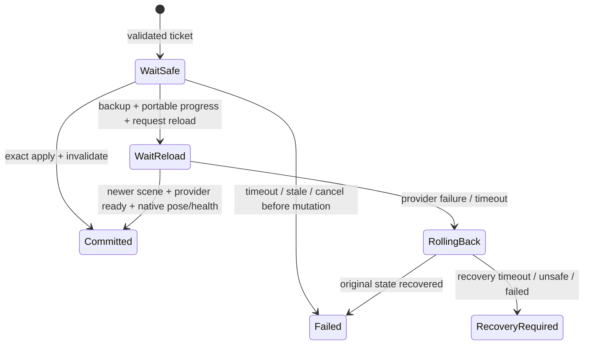

# Adapting Sunshine checkpoints to Hookshot

This adaptation is based on the actual Sunshine design and implementation at
[`chasem-dev/sms-pc-port` revision `736edaf`](https://github.com/chasem-dev/sms-pc-port/tree/736edafc72fc829f9466224754cb3621921c63df):
[`SAVE-STATES.md`](https://github.com/chasem-dev/sms-pc-port/blob/736edafc72fc829f9466224754cb3621921c63df/docs/SAVE-STATES.md),
[`savestate.cpp`](https://github.com/chasem-dev/sms-pc-port/blob/736edafc72fc829f9466224754cb3621921c63df/platform/savestate/savestate.cpp),
and [`port_savestate.h`](https://github.com/chasem-dev/sms-pc-port/blob/736edafc72fc829f9466224754cb3621921c63df/src/port_include/port_savestate.h).
The implementation here is independently written GPL-3.0-or-later code. No Sunshine
game code, patches, state layouts or compression implementation are copied.

## Implemented adaptation

| Sunshine mechanism | Hookshot implementation |
| --- | --- |
| Exact and portable data in one state | Schema 2 `META`, `PORT` and streamed `EXAC` blocks; explicit provider/schema negotiation |
| Build fingerprint and code anchor | Complete runtime identity plus native code/guest mapping anchors, memory-layout, thread and resource signatures |
| A state remembers its originating save file | Profile, save-data and slot binding; a different binding rejects rather than silently selecting or overwriting a file |
| Busy operations wait for later frames | Native coordinator retries at held boundaries for up to 500 ms; no sleeping on the guest thread |
| Portable load reloads even the current stage | `begin_portable` requests a new scene generation; position/health completion waits for that newer generation and the provider's readiness acknowledgement |
| Memory copied on the game thread, written on a worker | Worker writer accepts owned blocks and freezes small portable values; one write at a time; atomic replacement after read-back verification |
| Validate before copying memory | The file worker validates/stages first; runtime revalidation and a rollback capture precede the first mutation |
| Host resources remain outside the saved game | Explicit backend contract for native continuations, HLE handles, GPU/audio resources and cache invalidation; exact mode unavailable without it |

The implemented native coordinator is `host/checkpoint.c`; the file and worker
layer is `scripts/hookshot_statefile.py`. Tests execute the real coordinator with a
synthetic backend and exercise real files. **There is not yet an OoT game backend
or a verified whole-runtime rendezvous.** The normal game cannot save or load a
checkpoint through these modules yet. No load hotkeys or controller bindings are
installed, and `HOS_DEVTOOLS` remains a read-only observation switch.

## Why Sunshine's memory copy cannot be transplanted

Sunshine can run its operation at a frame-loop boundary while its scheduler owns
the game CPU and other game threads wait in compatible loops. Its snapshot excludes
platform globals and revalidates thread signatures. Hookshot's `hos_thread.c` runs
multiple native guest workers and fibers; its virtual-core scheduler can let another
waiter run after a scheduling escape. A lock in `hos_oot_lift_player` serializes that
hook, not the rest of the game, the native audio service, filesystem, or GPU replay.

Native frames may retain references into guest heaps. Parking a thread at an
arbitrary instruction does not make those references restorable. Exact support
requires either reconstructible continuations at proven boundaries or a complete
native-context strategy. Matching thread IDs or a matching executable is insufficient.
There is deliberately no force flag, `SuspendThread` shortcut or heap-only restore.

## File schema 2

The little-endian header is `HOSSTATE`, `u32 version=2`, `u32 chunk_count`.
Each chunk has a four-character uppercase tag, `u32 flags`, `u64 raw_bytes`, a
32-byte SHA-256 checksum, then its raw bytes. Flag bit zero means required; other
flags are rejected. The checksum covers the chunk index, tag, flags and bytes,
so moving otherwise intact exact blocks also disables exact restore.

`META` and `PORT` are required, unique, and first in that order. They contain
finite UTF-8 JSON, with duplicate keys rejected: 64 KiB for metadata and 4 MiB for
complete portable progress. `META` contains:

- The existing `Identity`: program ID, complete game build ID, runtime label and
  binary SHA-256, platform, state ABI, mod-set and configuration fingerprints.
- Provider ID/schema and the opaque originating `SaveBinding` (profile/save-data/slot).
- Optional `ExactContext`: native code anchor, actual guest mapping base and hashes
  of the complete memory layout, compatible native thread continuations and resource ABI.

The exact-context signatures must come from an audited runtime backend. The layout
and resource signatures must account for all relevant native module addresses,
memory sizes/permissions and recreation contracts, not merely version strings.
Thread signatures must cover continuation compatibility, not just a list of IDs.

`PORT` is provider-owned, pointer-free gameplay data. The provider validates its
complete schema and semantic limits before any native command is issued. An
observation export is always rejected as a restore payload.

`EXAC` is optional and repeatable: each block is at most 4 MiB, with at most 16 GiB
of exact data and 4098 chunks overall. Reading and staging use a bounded block
buffer rather than collecting the guest address space in a Python object. An exact
provider defines the internal memory/resource map; bytes cannot be copied blindly
into the guest window. This revision stores raw blocks; compression is not implemented.
Unknown optional chunks are integrity-checked and skipped; unknown required chunks,
duplicate metadata, bad framing, truncation and trailing bytes reject the file.

A corrupt exact block quarantines exact data while leaving a verified portable
fallback usable. Corrupt metadata or portable data rejects the whole checkpoint.
Checksums detect damage, not malicious authorship. Staged data remains untrusted
until the provider checks its own payload semantics.

Writes use a sibling temporary file, file flush/fsync, full read-back verification,
then atomic replacement. POSIX additionally flushes the parent directory. A directory
flush failure after replacement is reported as `CommittedStateError`, distinct from
a failure that preserved the previous state. Filesystem/power-loss guarantees still
depend on the platform. Original game save files are not written by this layer.

The old ZIP-based schema 1 remains readable for inspection, but restore selection
now rejects it: it has no native save binding or runtime context. It is not silently
upgraded using whichever file happens to be active.

## Native restore transaction

The backend prepares immutable input and a separate native-save backup on a worker.
It then submits a ticket on its owning thread. Request IDs increase monotonically;
process session IDs and save-binding SHA-256 values come from the actual runtime.
No path supplied by a checkpoint determines where the game saves.
`SaveBinding.digest()` specifies the native ticket hash: ASCII
`HOS-SAVE-BINDING-v1` plus a NUL byte, followed by profile, save-data and slot, each
as a little-endian u32 byte count and its UTF-8 bytes, in that order.



Every `tick` is called while the backend **holds**, until return, all reported
barriers. Portable operations require a frame boundary, parked guest workers, idle
I/O and a verified save binding. Exact operations additionally require GPU replay
and submissions drained, audio idle, and compatible thread/continuation state.
An old observation of idle devices does not satisfy the contract.
Workers must park outside locks needed by the callbacks; callbacks cannot wait
for a parked worker to finish an operation.
The I/O boundary includes native stream/decoder work that can retain guest buffers.
The controller retains missing safety bits in `blocked` on timeout, so an owner can
report whether workers, I/O, GPU, audio or thread compatibility prevented the operation.

Before mutation, `revalidate` checks the prepared payload and current runtime again,
then `backup` captures owned rollback state. The portable callback must synchronize
the outgoing scene's HUD/progress consumers before changing persistent flags and
request a genuine reload, even for the same map. A new scene counter alone is not
enough: `poll_reload` also checks the intended scene, age and player readiness.
`finish_portable` uses native physics setters for pose/health after that reload.

Failure after mutation starts recovery, never a second restore method. Recovery
may itself need an asynchronous scene transition; backup ownership is retained
until `poll_rollback` confirms completion. A 30-second reload/recovery timeout or
changed live session/save binding requires explicit recovery and retains the backup.
The coordinator refuses further operations and reset in `RECOVERY_REQUIRED`.
Cancellation is supported only before mutation; the API reports busy afterwards.

The exact provider validates every staged memory/resource range before copying,
keeps host-only scheduler/filesystem/device state out of game-memory ranges, and
invalidates write tracking and reconstructed GPU/audio resources before success.
If invalidation fails, rollback must restore those resources too. An unsuccessful
rollback cannot be reported as a completed load.

## The remaining OoT backend

The reviewed existing code gives several integration points, but does not establish
the missing safety/progress guarantees:

| OoT data or operation | Existing Hookshot code | Backend requirement |
| --- | --- | --- |
| Scene and age | `oot_gamedata_string` (`Sequence_CurrentBanc`) and `oot_gamedata_bool` (`Sequence_IsChildhood`), `host/hos_main.c` | Capture together with audited persistent progress; reject title/loading/cutscene states |
| Persistent progress | GameDataMgr and the game's native save serializer | Export the complete persistent schema and validate/migrate it; do not copy GameDataMgr pointers or assume all flags are persistent |
| Stage reconstruction | `oot_teleport` and native Banc-change events | Restore flags/age first, reload the target even if already there, wait for actual scene-generation completion; no guessed sleep |
| Player pose | Existing native change-position/controller path in `oot_update_player_cheats` | Resolve the new controller after reload, validate scene bounds and actor state, then apply through physics |
| Native save ownership | `MountSaveData` and save handles in `host/nn_fs.c` | Bind actual profile/save-data/slot; inhibit autosave during transition and recovery; revalidate native save stamps before re-enabling writes |
| Runtime rendezvous | Guest workers/fibers in `host/hos_thread.c`, native audio and replay queues | Prove no conflicting mutation, live continuation hazards, pending I/O or captured GPU work; release barriers only after the transaction's tick returns |

The portable record must include scene, age, valid pose, health and complete
persistent progress from that audited serializer. Camera/motion/mount states need
explicit support or a declared normal-player reconstruction; silently dropping
progress or calling a scene/position bookmark a save state is not acceptable.

Acceptance requires isolated test saves: same-map and cross-map reloads, child/adult
changes, dialogue/cutscene rejection, a state older than the latest native save,
wrong-slot rejection, injected transition failure and rollback, and a later build
restoring portable progress. Exact support additionally needs measured worker,
GPU, audio and I/O quiescence and repeated restores while those systems were active.
None of those gameplay acceptance gates is claimed by the game-free tests.

## Run the checks

```text
python -I -B tests/test_checkpoint_statefile.py
python -I -B tests/test_checkpoint_coordinator.py --cxx clang++
python -I -B tests/test_checkpoint_envelope.py
python -I -B tests/test_devtools.py --cxx clang++
python -I -B tests/run_all.py
```

Only synthetic values and source code enter CI. State files, extracted memory,
native-save backups and game-derived layouts remain local and ignored by Git.

Local validation on 2026-11-10 (Windows, Python 3.14.7, llvm-mingw Clang 23.1.5):
18 new file/worker/preflight tests, the compiled native coordinator fixture, the
12 legacy-envelope checks and the existing observer/CLI fixture passed. The native
coordinator also compiles at the runtime's `-O2` setting. The full game-free suite
reported 288 passed, 2 failed and 21 skipped. The failures are the same upstream
Windows path-prefix fixture and missing MSVC `windows.h` environment described in
[devtools.md](devtools.md); neither touches the checkpoint implementation.
